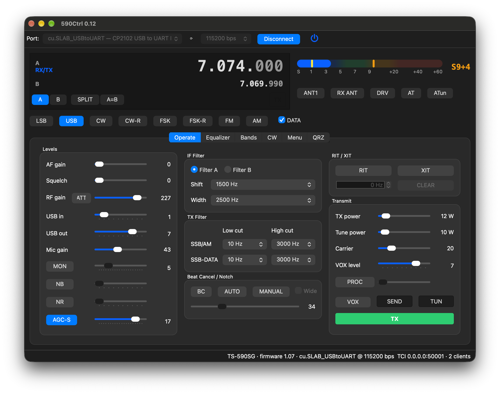

# 590Ctrl

A desktop control panel for the **Kenwood TS-590SG** over its USB port, for
macOS and Linux. Written in C++20 with Qt 6.



Version 0.13 · Licensed under the [GPL-3.0](LICENSE).

## Features

**Tuning and modes**
- VFO A and B displays: scroll over any digit to tune it (one step per wheel
  click), or double-click to type a frequency
- RX/TX VFO selection, split, A=B
- Mode buttons (LSB, USB, CW, CW-R, FSK, FSK-R, FM, AM) and DATA
- RIT / XIT with a signed offset and CLEAR
- **Bands** tab: 1.8–50 MHz and GENE; click the current band again to step
  through its band memories

**Receive**
- AF gain, squelch, RF gain with an ATT → PRE → off button
- NB (NB1 / NB2 / both) and NR (NR1 / NR2), each with its level
- AGC off / slow / fast, with the time constant for the active mode
- IF filter A/B with the mode-dependent high/low-cut or width/shift controls
- Beat cancel (BC1 / BC2), and auto and manual notch with bandwidth and position
- **MUTE** silences the received audio on the speaker and on the USB output to
  the computer and TCI programs (the USB output level returns on unmute); red
  while on
- **LOCK** and **FINE**, as the radio's keys
- Antenna: ANT1/ANT2, RX ANT, DRV, and the internal tuner (AT in line, ATun to
  run a tune cycle)

**Transmit**
- TX power, tune power, carrier level, mic gain, VOX, VOX level and VOX delay
- Speech processor with input and output levels
- TX monitor with level
- TX filter low/high cut for SSB/AM and SSB-DATA
- SEND (latching), TUN (latching tune carrier at tune power) and a momentary TX
  button. The app always releases transmit before disconnecting or quitting.

**CW** tab
- Keyer speed, pitch, break-in on/off with its delay (or full break-in), and
  CW TUNE
- Keyboard CW: type a line and press Enter; longer text is fed to the radio as
  its buffer frees up, and STOP drops what hasn't been keyed yet
- The TS-590SG's Morse decoder with its threshold and a scrolling text window
  (CW and CW-R only; DECODE is greyed out in other modes)

**QRZ** tab
- Look up a callsign on QRZ.com (XML data service) and see every field QRZ
  returns, with the operator's photo; double-click the call, web page, email
  or image to open it
- With a Logbook API key, each lookup also checks your QRZ Logbook: a call
  you've worked turns green, with the date, time, band and mode of the last
  QSO and how many you've logged
- **Log Contact** adds the QSO to your QRZ Logbook through its API: frequency
  (and RX frequency when split), band, mode, TX power and the current UTC time
  come from the radio and the system; RST, comment, and the name, QTH, grid,
  DXCC, state/county and zones from the lookup are included
- SSB-DATA logs as PSK31 by default; pick FT8, FT4, RTTY, PSK, MFSK, OLIVIA,
  THOR or HELL when you're using something else
- **Account…** holds your QRZ username and password, station callsign, and
  the Logbook API key (only needed for logging; logging through the API needs
  a QRZ subscription). A remembered password is stored unencrypted in the
  app's settings file.

**Menu** tab
- Every EX menu item for both of the radio's menu sets side by side, **Menu A**
  and **Menu B**, each editable in place: a list of the radio's choices, a
  function number for the PF and key assignments, or text for the power-on
  message. Rows where A and B differ are shown in bold.
- **Menu in use: A / B** switches the radio between its two menu sets; the rest
  of the app follows the new set (USB audio levels, TX filters, power fine, CW
  pitch, filter controls)
- **Copy A → B** and **Copy B → A** write one set into the other, after
  showing how many settings will change
- Filter by menu number or name, and **Reload** to read both sets again
- Covers the TS-590SG's menus 000–099 and the TS-590S's 000–087. The COM and
  USB port speeds are shown but not editable, since changing the one 590Ctrl
  is connected through would drop the connection. See [Menu notes](#menu-notes).

**TCI server** (**Tools → TCI Server…**)
- Lets TCI programs such as WSJT-X, fldigi and TCIdigi control the radio
  while 590Ctrl holds the serial port, so they share it instead of fighting
  over it
- VFO, mode (DIGU/DIGL are USB/LSB with DATA), PTT, tune, drive and tune
  drive, split, RIT/XIT, RX filter band, CW macros and speed, and RX/TX meters.
  A change from the radio, from 590Ctrl or from any client reaches every
  client, and 590Ctrl's own display follows changes the clients make.
- Audio over TCI: the radio's USB codec is streamed to clients (48 kHz,
  resampled to 24, 12 or 8 kHz on request), and a client's transmit audio is
  played into it. A client that sends TCI audio and keys up transmits with
  DATA SEND, so its audio is what goes out.
- A client that disconnects while transmitting unkeys the radio
- Listens on this computer only or on every network interface, on a port you
  choose; TCI connections and traffic appear in the CAT monitor.
  See [Using TCI programs](#using-tci-programs).

**Meter**
- S-meter with S1–S9 / +20–+60 dB scale, smooth color zones, peak hold and an
  RF gain marker
- A green SQL over the peak readout while the squelch is set and open
- On transmit: power in watts, SWR, speech-processor compression in dB, and ALC

**Equalizer**
- 18-band RX and TX editors for the radio's EQ, including the User (U) curve
- Named presets (save, apply, import/export as JSON) and per-mode auto-load
  into the User curve; see [Equalizer notes](#equalizer-notes)

**Radio and app**
- Power the radio on and off from the app, including waking a radio that was
  switched off at its front panel
- USB audio in/out levels
- Auto-detects the radio's USB serial port
- Built-in simulator for trying the app without a radio
- CAT monitor (**View → CAT Monitor**) showing raw radio traffic
- **View → Style** (macOS, Fusion, …) and **View → Appearance** (System, Light,
  Dark)

## Installing on macOS

Download `590Ctrl-0.13.dmg` from the
[Releases](https://github.com/kingsqueak/590Ctrl/releases) page, open it, and
drag **590Ctrl-0.13** to **Applications**. The app's name carries its version;
delete the older copy (0.10 was plain `590Ctrl.app`) once the new
one runs. Settings are kept. It runs on macOS 26.0 or later, on both
Apple silicon and Intel Macs.

The app isn't notarized by Apple, so the first launch is blocked. Open it
once, then go to **System Settings → Privacy & Security** and click **Open
Anyway**. Alternatively, run:

```sh
xattr -dr com.apple.quarantine /Applications/590Ctrl-0.13.app
```

## Building from source

Requires **Qt 6.8 or newer** (Core, Widgets, SerialPort, Network, WebSockets,
Multimedia), CMake 3.21+, Ninja and a C++20 compiler.

### macOS

```sh
brew install qt cmake ninja
git clone https://github.com/kingsqueak/590Ctrl.git
cd 590Ctrl
cmake -S . -B build -G Ninja -DCMAKE_BUILD_TYPE=Release
cmake --build build
(cd build && ctest --output-on-failure)   # optional: run the tests
open build/590Ctrl.app
```

Homebrew's Qt is built for the macOS version it's installed on, so an app
bundled from it only runs on that version or newer. To make a DMG for older
macOS versions, build against the official Qt binaries instead (see
[Making a DMG](#making-a-dmg)).

### Linux

Qt 6.8 or newer ships with Debian 13, Ubuntu 25.04+, Fedora 41+ and Arch.
Install the build dependencies:

```sh
# Debian / Ubuntu
sudo apt install build-essential cmake ninja-build git qt6-base-dev libqt6serialport6-dev \
    libqt6websockets6-dev qt6-multimedia-dev

# Fedora
sudo dnf install gcc-c++ cmake ninja-build git qt6-qtbase-devel qt6-qtserialport-devel \
    qt6-qtwebsockets-devel qt6-qtmultimedia-devel

# Arch
sudo pacman -S base-devel cmake ninja git qt6-base qt6-serialport qt6-websockets qt6-multimedia
```

Then build and run:

```sh
git clone https://github.com/kingsqueak/590Ctrl.git
cd 590Ctrl
cmake -S . -B build -G Ninja -DCMAKE_BUILD_TYPE=Release
cmake --build build
(cd build && ctest --output-on-failure)   # optional: run the tests
./build/590Ctrl
```

Your user needs access to the serial port: add it to the `dialout` group
(`uucp` on Arch), then log out and back in.

```sh
sudo usermod -aG dialout "$USER"
```

### Making a DMG

The release DMG is built against the official Qt binaries, which are
self-contained and support older macOS versions. One way to get them is
[aqtinstall](https://github.com/miurahr/aqtinstall):

```sh
python3 -m venv aqtenv && ./aqtenv/bin/pip install aqtinstall
./aqtenv/bin/aqt install-qt mac desktop 6.12.0 clang_64 -m qtserialport qtwebsockets qtmultimedia -O ~/Qt

scripts/make-dmg.sh ~/Qt/6.12.0/macos
```

The script builds a universal (arm64 + x86_64) release for macOS 26.0+, runs
`macdeployqt`, names the bundle `590Ctrl-<version>.app`, signs it ad hoc,
checks that every binary runs on macOS 26 and links only inside the bundle,
and writes `build-release/590Ctrl-<version>.dmg`.

## Connecting the radio

The TS-590SG's USB-B port carries two devices: a USB audio codec ("USB Audio
CODEC") and a Silicon Labs CP2102 serial bridge for CAT control. 590Ctrl
uses the serial bridge and picks it automatically (VID 10C4, PID EA60).

* **macOS:** use `cu.SLAB_USBtoUART`. If the Silicon Labs VCP driver is
  installed, the same CP2102 also appears as `cu.usbserial-<serial>`, which
  stays silent. 590Ctrl lists the SLAB port first.
* **Linux:** the port is `/dev/ttyUSB0` (or similar).
* **Speed:** must match radio menu **068** (USB port communication speed).
  The factory default is 115200 bps.
* **RTS:** the radio only sends data while RTS is asserted, so 590Ctrl holds
  RTS high and DTR low. If you've assigned RTS to PTT in the radio's menus,
  connecting will key the transmitter.

While connected, 590Ctrl turns on Auto Information (`AI2`, which the radio
doesn't save), so changes made on the radio show up in the app. It puts back
the radio's previous AI setting when it disconnects.

The power button next to **Connect** turns the radio on and off. If the radio
was switched off at its front panel, pressing it while disconnected wakes the
radio and connects.

No radio handy? Pick **Simulator (no radio)** as the port.

## Using TCI programs

Turn the server on in **Tools → TCI Server…** and pick the address and port.
**127.0.0.1** keeps it to this computer; **0.0.0.0** also accepts programs
on other machines on your network. The default port is 40001, the same as
ExpertSDR. Tick **Share the radio's USB audio** to stream the radio's audio
over TCI; leave it off if the program uses the USB Audio CODEC directly.

Then point the program at that address and port:

* **WSJT-X:** *Settings → Radio*, Rig **TCI Client RX1** (address and port as
  above), PTT method **CAT**. Under *Settings → Audio*, choose **TCI audio**
  for input and output to use the shared audio. Mode **None** or **Data/Pkt**
  both work.
* **fldigi / TCIdigi:** enable TCI and enter the same address and port.

590Ctrl must be connected to the radio: until it is, the server tells clients
the radio is off (`stop;`), and WSJT-X reports "TCI SDR is not switched on".
Clients can't power the radio on or off.

Older WSJT-X releases compared TCI mode names case-sensitively and dropped
the connection with "TCI failed set mode"; 590Ctrl sends lower-case names, as
ExpertSDR does, so they work. Fixes for WSJT-X itself are proposed upstream in
[WSJTX/wsjtx#137](https://github.com/WSJTX/wsjtx/pull/137) and
[#138](https://github.com/WSJTX/wsjtx/pull/138).

## Menu notes

* The radio has no command for "menu B" as such: menu commands always act on
  the set in use. To read or change the other set, 590Ctrl switches the radio
  to it and straight back, so for that moment its settings (such as the USB
  audio levels) apply. The switch, the menu accesses and the switch back are
  queued together, so no other command from the app lands in the wrong set.
* Both sets are read the first time you open the **Menu** tab after
  connecting, which takes a few seconds.
* PF and key assignments are shown as the radio's function numbers (255 =
  OFF); the instruction manual lists what each number does.
* The Kenwood reference lists 0.5 kHz twice for TS-590SG menus 016 and 017
  (MULTI/CH step for SSB and CW/FSK). The radio has it once (checked on
  firmware 1.07), and 590Ctrl follows the radio.

## Equalizer notes

* The EQ curve is selected per mode family (SSB, SSB-DATA, CW, FM, FM-DATA,
  AM, AM-DATA, FSK). The editor always works on the family for the current
  mode.
* The radio keeps one User curve for RX and one for TX, shared by every mode
  family set to **U** (checked on a TS-590SG with firmware 1.07). Editing U in
  SSB also changes U in SSB-DATA, AM and the rest.
* Band levels can always be read, but writing them fails while the curve is
  OFF. Per the Kenwood reference, only the **U** curve keeps them in the radio.
* TX EQ is fixed OFF in CW and FSK.

### Presets and auto-load

Each EQ panel has a preset library: **Save As…** stores the current levels
under a name, **Apply** writes the selected preset to the radio, and
**More → Import/Export** moves presets in and out as JSON files. Presets live
in the app data directory (`~/Library/Application Support/590Ctrl/590Ctrl/eq-presets`
on macOS, `~/.local/share/590Ctrl/590Ctrl/eq-presets` on Linux).

The radio has only one User curve, so **Auto-load into U** gives each mode
family its own curve anyway. Link a preset to the current mode family (e.g.
"Speech" for SSB, "Data RX" for SSB-DATA). When you enter that mode and its
curve is U, 590Ctrl writes the preset into the User curve. Choosing
**(none)** leaves U as it is.

## Meter calibration

The radio reports its meters as 0–30 display dots. 590Ctrl converts them using
points read off a TS-590SG's display:

| Meter | Calibration |
|---|---|
| S-meter | S1, S3, S5, S7, S9 every 3 dots (S9 = 15), then +20/+40/+60 dB every 5 |
| Power | 5 dots = 10 W, 10 = 25 W, 15 = 50 W, 30 = 100 W |
| SWR | 5 dots = 1.5, 10 = 2.0, 15 = 3.0 (shown as ">3" above that) |
| COMP | 1 dB per dot |
| RF gain marker | Linear, not yet calibrated |

## Project layout

| Path | Contents |
|---|---|
| `src/core/CatCodec.*` | CAT command encoders/parsers, spec tables, meter calibration |
| `src/core/CatLink.*` | Framing, one-at-a-time command queue, error attribution, coalescing |
| `src/core/Radio.*` | Radio state model: setters, AI handling, power, initial sync |
| `src/core/MenuTable.*` | EX menu lists for the TS-590S and TS-590SG |
| `src/core/EqPresetLibrary.*`, `EqAutoLoader.*` | EQ presets and per-mode auto-load |
| `src/core/TciServer.*` | TCI (WebSocket) server: CAT control and audio for TCI programs |
| `src/core/RadioAudio.*`, `Resampler.*` | The radio's USB audio codec, and rate conversion for TCI clients |
| `src/core/SerialTransport.*` | QSerialPort transport and port discovery |
| `src/core/SimulatorTransport.*` | In-process fake TS-590SG for tests and offline use |
| `src/app/` | Qt Widgets UI |
| `tests/` | QtTest suites (codec, link, radio, presets, QRZ, TCI server and resampler, against the simulator) |

Protocol reference: Kenwood *TS-590S/SG PC Control Command Reference Guide*
(B5A-0316-20/01).

## License

Copyright (C) 2026 KC2RGW Chris Esser

590Ctrl is free software: you can redistribute it and/or modify it under the
terms of the GNU General Public License as published by the Free Software
Foundation, either version 3 of the License, or (at your option) any later
version.

590Ctrl is distributed in the hope that it will be useful, but WITHOUT ANY
WARRANTY; without even the implied warranty of MERCHANTABILITY or FITNESS FOR A
PARTICULAR PURPOSE. See the [GNU General Public License](LICENSE) for more
details.

590Ctrl uses [Qt](https://www.qt.io/), which is licensed under the GNU LGPL v3.
